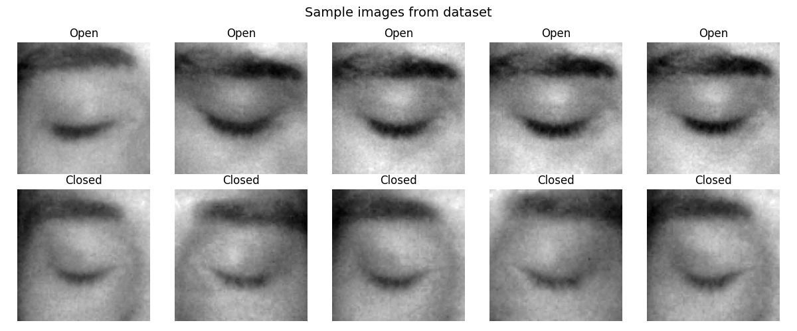
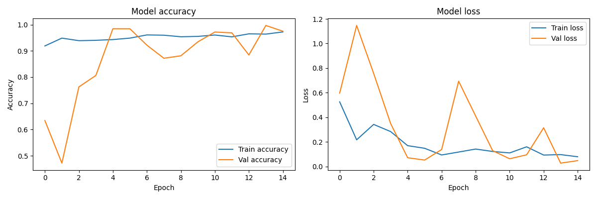

# 😴 Worker Fatigue Detection System


A real-time worker fatigue detection system built for a **Computer Vision for Industry 5.0** university course. The system uses a webcam to continuously monitor a worker's face and detects signs of fatigue by measuring eye openness using the **EAR (Eye Aspect Ratio)** algorithm combined with a **CNN deep learning model** trained on 4000 eye images.



---

## ✨ Features

- 👁️ **Real-time eye state detection** via webcam with 200ms frame polling
- 🧠 **CNN model** trained on 4000 eye images achieving **98.5% test accuracy**
- 📐 **EAR (Eye Aspect Ratio)** scoring using MediaPipe's 468 facial landmarks
- 🟩 **Animated face tracking box** that follows the face and changes color based on fatigue status
- 🚨 **Fatigue alert** triggers after 30 consecutive closed-eye frames
- 🔔 **Sound alert** plays automatically when fatigue is detected
- 🎯 **Personal calibration tool** that measures individual EAR baseline values
- 📈 **Live EAR score chart** updating in real time with Recharts
- 📊 **Session statistics** — monitoring time, fatigue event count, eyes closed percentage
- 📸 **Automatic screenshot** saved locally when fatigue is detected
- ⚙️ **Sensitivity presets** — Light Worker, Normal, Heavy Machinery
- 🌙 **Dark / Light mode** toggle
- 💻 Modern React dashboard powered by a FastAPI backend

---

## 🏗️ Project Structure

```
worker-fatigue-detection/
├── api.py                  # FastAPI backend server
├── train_model.py          # CNN model training script
├── calibrate.py            # Personal EAR threshold calibration tool
├── explore_data.py         # Dataset exploration and visualization script
├── requirements.txt        # Python dependencies
├── models/
│   ├── eye_state_model.keras   # Trained CNN model weights
│   ├── face_landmarker.task    # MediaPipe face landmark model
│   └── ear_threshold.txt       # Saved personal EAR threshold
├── frontend/
│   ├── src/
│   │   ├── App.jsx         # Main React dashboard component
│   │   ├── main.jsx        # React entry point
│   │   └── index.css       # Global styles (Tailwind)
│   ├── public/             # Static assets
│   ├── index.html
│   ├── vite.config.js
│   └── package.json
├── data/
│   └── train/
│       ├── Closed_Eyes/    # 2000 closed eye images
│       └── Open_Eyes/      # 2000 open eye images
└── assets/                 # Screenshots and documentation images
```

---

## 🛠️ Tech Stack

### Frontend
| Technology | Purpose |
|---|---|
| React 18 | UI framework |
| Vite | Build tool and dev server |
| Tailwind CSS | Utility-first styling |
| Recharts | Live EAR score chart |
| Lucide React | Icon library |

### Backend
| Technology | Purpose |
|---|---|
| FastAPI | REST API server |
| MediaPipe | 468-point facial landmark detection |
| TensorFlow / Keras | CNN model inference |
| OpenCV | Frame capture and image processing |
| SciPy | EAR geometric distance calculations |

---

## 🧠 How It Works

```
Webcam → FastAPI → MediaPipe → EAR Calculation → CNN Inference → Fatigue Decision → React Dashboard
```

1. **Frame capture** — The React frontend polls the FastAPI backend every 200ms, sending the latest webcam frame.
2. **Landmark detection** — MediaPipe processes the frame and detects 468 facial landmarks.
3. **EAR calculation** — The Eye Aspect Ratio is computed from 6 key eye landmark coordinates:

$$EAR = \frac{A + B}{2 \times C}$$

Where A and B are the vertical eye distances and C is the horizontal eye distance.

4. **CNN inference** — The eye region is cropped, resized to 97×97 grayscale, and passed through the trained CNN to classify as open or closed.
5. **Fatigue detection** — If the EAR drops below the personal calibrated threshold, the eye is marked as closed. After **30 consecutive closed frames**, a fatigue alert is triggered.
6. **Alert** — A sound plays, a screenshot is saved automatically, and the dashboard displays a fatigue warning.
7. **Dashboard update** — The React frontend updates the live EAR chart, face tracking box color, and session statistics in real time.

---

## 🤖 Model Performance

The CNN was trained on the [MRL Eye Dataset](https://www.kaggle.com/datasets/tauilabdelilah/mrl-eye-dataset) from Kaggle.

| Metric | Value |
|---|---|
| Dataset | MRL Eye Dataset |
| Total Images | 4,000 |
| Closed Eyes | 2,000 |
| Open Eyes | 2,000 |
| Train / Test Split | 80% / 20% |
| Image Size | 97 × 97 grayscale |
| Test Accuracy | **98.50%** |
| Test Loss | **0.0461** |

### Architecture

```
Input (97×97×1)
    ↓
Conv2D(32) → BatchNorm → MaxPooling
    ↓
Conv2D(64) → BatchNorm → MaxPooling
    ↓
Conv2D(128) → BatchNorm → MaxPooling
    ↓
Flatten → Dense(128) → Dropout(0.5)
    ↓
Dense(1) → Sigmoid
```



---

## 🚀 Getting Started

### Prerequisites

- Python 3.11
- Node.js 18+
- A webcam

### 1. Clone the repository

```bash
git clone https://github.com/your-username/worker-fatigue-detection.git
cd worker-fatigue-detection
```

### 2. Set up the Python environment

```bash
python -m venv venv

# Windows
venv\Scripts\activate

# macOS / Linux
source venv/bin/activate

pip install -r requirements.txt
```

### 3. Calibrate your personal EAR threshold

This step measures your individual eye openness baseline for accurate detection.

```bash
python calibrate.py
```

Follow the on-screen instructions. Your threshold will be saved to `models/ear_threshold.txt`.

### 4. Start the backend

```bash
uvicorn api:app --host 0.0.0.0 --port 8000 --reload
```

The API will be available at `http://localhost:8000`. You can explore the auto-generated docs at `http://localhost:8000/docs`.

### 5. Start the frontend

```bash
cd frontend
npm install
npm run dev
```

### 6. Open the dashboard

Navigate to `http://localhost:5173` in your browser.

---

## ⚙️ Sensitivity Presets

| Preset | Use Case | Closed Frame Threshold |
|---|---|---|
| Light Worker | Office / desk work | 35 frames |
| Normal | General use | 30 frames |
| Heavy Machinery | High-risk environments | 20 frames |

---

## 📁 Dataset

The model was trained on the **MRL Eye Dataset**, a large-scale dataset of eye images collected under various lighting conditions, subjects, and camera setups.

- Source: [Kaggle — MRL Eye Dataset](https://www.kaggle.com/datasets/tauilabdelilah/mrl-eye-dataset)
- Classes: `Open_Eyes`, `Closed_Eyes`
- Images used: 4,000 (balanced subset)

To explore the dataset distribution and sample images:

```bash
python explore_data.py
```

---

## 📄 License

This project is licensed under the **MIT License**.

```
MIT License

Copyright (c) 2026

Permission is hereby granted, free of charge, to any person obtaining a copy
of this software and associated documentation files (the "Software"), to deal
in the Software without restriction, including without limitation the rights
to use, copy, modify, merge, publish, distribute, sublicense, and/or sell
copies of the Software, and to permit persons to whom the Software is
furnished to do so, subject to the following conditions:

The above copyright notice and this permission notice shall be included in all
copies or substantial portions of the Software.

THE SOFTWARE IS PROVIDED "AS IS", WITHOUT WARRANTY OF ANY KIND, EXPRESS OR
IMPLIED, INCLUDING BUT NOT LIMITED TO THE WARRANTIES OF MERCHANTABILITY,
FITNESS FOR A PARTICULAR PURPOSE AND NONINFRINGEMENT. IN NO EVENT SHALL THE
AUTHORS OR COPYRIGHT HOLDERS BE LIABLE FOR ANY CLAIM, DAMAGES OR OTHER
LIABILITY, WHETHER IN AN ACTION OF CONTRACT, TORT OR OTHERWISE, ARISING FROM,
OUT OF OR IN CONNECTION WITH THE SOFTWARE OR THE USE OR OTHER DEALINGS IN THE
SOFTWARE.
```

---